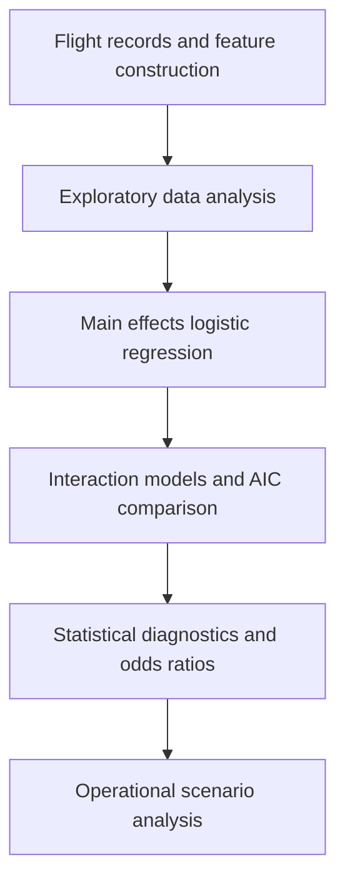
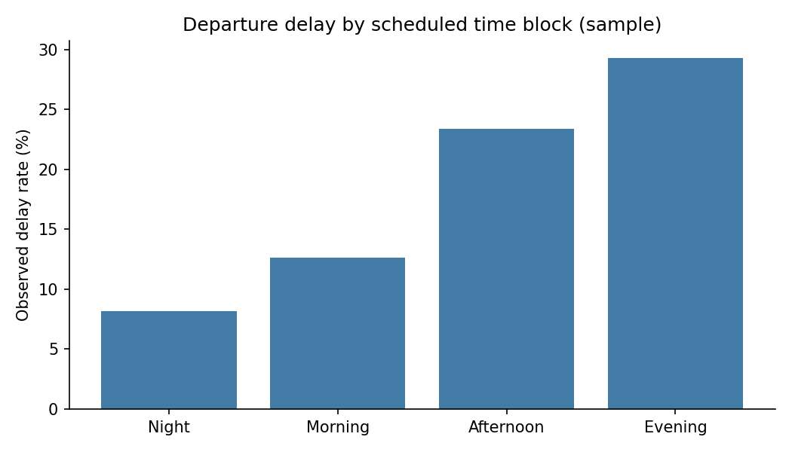
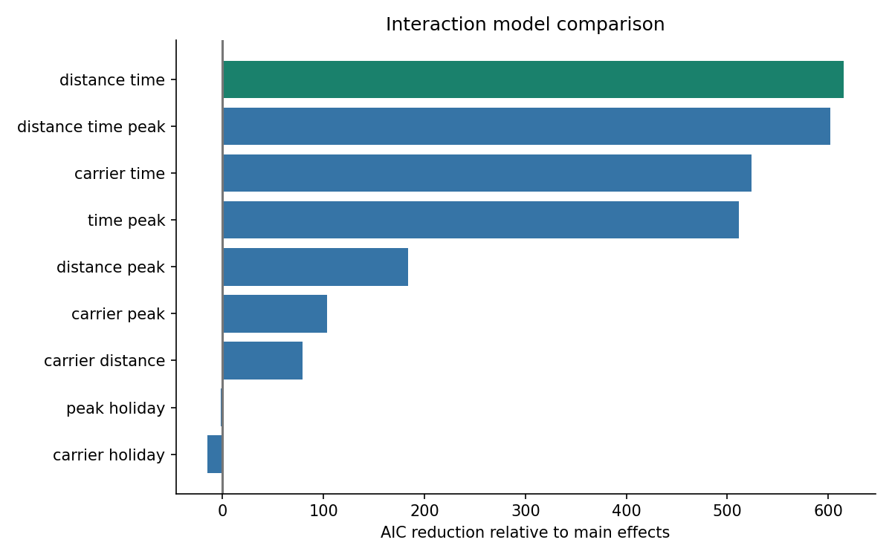
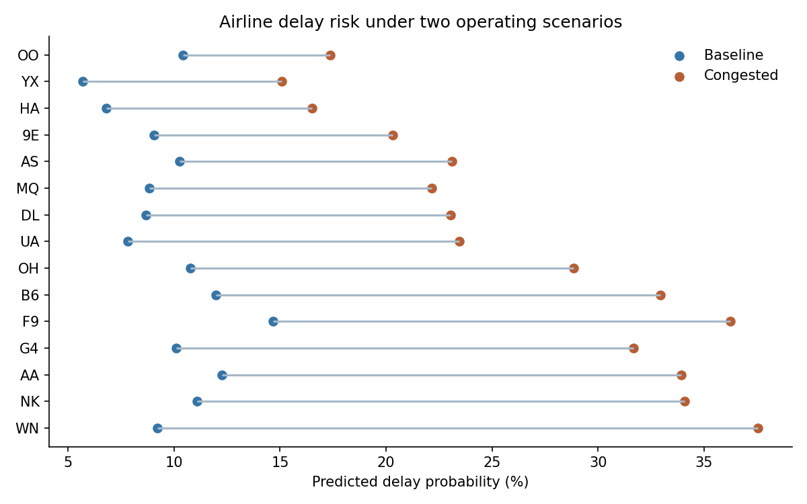

# Flight Delay Statistical Modeling

**Generalized linear models · Statistical inference · Interaction analysis · Operational risk analytics**

A six-person team project for the Statistical Data Analysis for Business and Management course at National Taiwan University.

## Overview

Flight delays are influenced by scheduling conditions, route characteristics, and differences across airlines. We studied departure delay risk using 2024 U.S. domestic flight records from the Bureau of Transportation Statistics. The analysis combines interpretable statistical modeling with scenario-based risk measures to inform operational planning and flight selection.

## My Contributions

- Implemented exploratory data analysis in R to examine delay patterns, variable relationships, and potential interaction effects.
- Developed binomial generalized linear models and evaluated alternative interaction specifications using backward selection, AIC, and likelihood ratio tests.
- Conducted model diagnostics, including generalized variance inflation factors, Pearson dispersion, deviance residual analysis, and Cook's distance.
- Interpreted regression coefficients, odds ratios, and interaction effects to assess differences in airline delay risk.
- Developed scenario-based absolute and relative delay sensitivity measures to compare airlines under different operating conditions.

The statistical analysis and modeling were my primary contributions. Other team members contributed to upstream preprocessing. Results represent team-level achievements.

## Data and Analytical Workflow

The 2024 source dataset contains approximately seven million flight records. A random sample of 200,000 records was used for model development; 196,774 remained after excluding canceled and diverted flights. The response indicates a departure delay strictly greater than 15 minutes. Predictors include scheduled departure time, calendar conditions, route distance, airport groups, and operating airline. Post-departure delay components are excluded from the regression.





## Statistical Modeling

The final binomial GLM retains the main effects and two interactions: airline × log distance and airline × scheduled time block. These interactions capture how the relationship between delay risk and operating conditions varies across airlines.

| Model | AIC |
|---|---:|
| Main effects | 183504.8 |
| Carrier × distance | 183425.5 |
| Carrier × time block | 182980.5 |
| Carrier × peak time | 183401.2 |
| **Carrier × distance + carrier × time block** | **182889.6** |

The selected model lowers AIC by 615.1 and reduces deviance by 727.1 on 56 additional degrees of freedom (likelihood ratio test, p < 0.001). See the [full model comparison](results/model_comparison.csv) and [statistical formulation](docs/statistical_model.md).



## Model Diagnostics

| Metric | Value |
|---|---:|
| McFadden pseudo-R² | 0.0691 |
| Pearson dispersion | 1.0074 |
| Training ROC AUC | 0.6835 |
| Training accuracy (0.5 threshold) | 80.24% |

The modeling emphasis is on interpretable associations and differences in predicted risk across operating conditions. Diagnostic procedures and coefficient interpretation are documented in [methodology](docs/methodology.md).

## Operational Risk Analysis

To compare airline risk under common modeled conditions, we fix the reference distance, airport groups, month, and weekday, then change the departure time block and demand-related indicators. Absolute sensitivity is the difference in predicted delay probabilities; relative sensitivity is their ratio.

| Airline code | Baseline | Congested | Absolute change | Relative risk |
|---|---:|---:|---:|---:|
| OO | 10.41% | 17.36% | +6.95 pp | 1.67× |
| YX | 5.71% | 15.08% | +9.38 pp | 2.64× |
| HA | 6.79% | 16.52% | +9.73 pp | 2.43× |
| WN | 9.20% | 37.55% | +28.34 pp | 4.08× |



## Key Findings and Business Implications

- **Delay risk varies across departure times.** Observed delay rates in the modeling sample rise from 12.6% in the morning to 23.4% in the afternoon and 29.3% in the evening, highlighting the importance of time-dependent operational planning.
- **Airline performance is context-dependent.** The interaction analysis indicates that associations between delay risk, route distance, and departure time differ across carriers. Average delay rates alone can therefore obscure meaningful differences in conditional risk.
- **Sensitivity analysis reveals differences in operational risk profiles.** SkyWest, Republic, and Hawaiian exhibit increases of less than 10 percentage points between the specified scenarios, while Southwest's predicted delay probability rises from 9.2% to 37.5%.

These findings support a more context-sensitive approach to airline scheduling, performance benchmarking, and resource allocation. Airlines and airport operators could use conditional risk estimates to identify vulnerable operating periods and prioritize staffing, turnaround buffers, and contingency planning. Passengers could also consider departure time and carrier-specific risk profiles when choosing flights.

## Analysis Files

| Analysis | Focus |
|---|---|
| [01 — Exploratory data analysis](analysis/01_exploratory_data_analysis.Rmd) | Distributions, relationships, and interaction patterns |
| [02 — GLM model selection](analysis/02_glm_model_selection.Rmd) | Main effects, backward selection, AIC and likelihood ratio tests |
| [03 — Model diagnostics](analysis/03_model_diagnostics.Rmd) | GVIF, residuals, influence, and in-sample metrics |
| [04 — Operational risk analysis](analysis/04_operational_risk_analysis.Rmd) | Scenario predictions and absolute/relative sensitivity |

Core implementations are in [`R/`](R/). Aggregate numerical results are in [`results/`](results/).

## Running the Analysis

Install R dependencies and place the modeling sample locally as described in [data requirements](data/README.md). From the repository root:

```bash
Rscript scripts/install_dependencies.R
Rscript scripts/run_analysis.R data/raw/flight_data_2024_sample_200k.csv
```

The optional full-year scoring script accepts the complete source CSV. Sample metrics and scenario estimates describe the fitted model, not independent prospective validation. The recorded sample results were numerically verified using the same binomial likelihood and feature definitions; the R scripts are provided for the analysis workflow.
